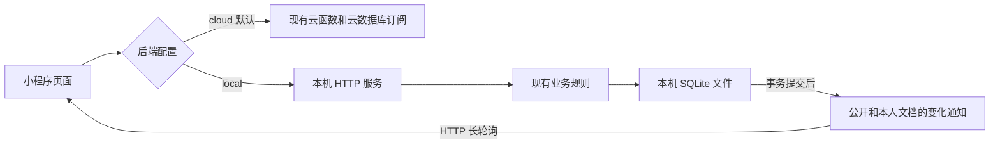

# 本地后端耗时验证方案

## 目的与边界

在当前电脑单机运行 Node.js 后端和 SQLite，验证后端处理时间对请求确认、状态接收和页面渲染的影响。云开发为默认后端；切换只修改 `miniprogram/config/backend.ts`，不修改云函数、云库数据、权限或部署配置。本地数据库从空库开始，不导入真实数据。

复用 `cloudfunctions/api/index.js` 和它的规则、投影、幂等、定时任务模块。本地运行器仅注入云 SDK 的数据库和身份接口，不修改全局 require，不加载实际云 SDK。这样两条链路使用同一套业务规则。

## 架构



- API 保留 `{ action, payload, traceId, delivery, testUser }` 和原返回协议。
- SQLite 保存集合名、文档 ID 和 JSON 文档，提供项目实际使用的读写、查询、替换、日期和事务语义。使用 WAL 和完整同步写入，不用内存库冒充本地数据库。
- 单进程串行执行业务请求和后台任务，避免 SQLite 异步事务交错；排队时间单独记录。此方案是单机实验实现，不代表高并发生产架构。
- 保留公开状态、本人私有状态和笔记的现有订阅/合并逻辑。长轮询首次返回快照，之后只在相关文档提交变化后返回；超时续连不调用游戏查询接口。事务回滚不通知。重连重新校验身份并取得快照。
- 后台每秒执行现有 `advanceGames`，任务保存在 SQLite，重启后继续处理到期任务。
- 使用显式本地测试身份和访问密钥，身份与云端隔离。虚拟身份仍支持现有房主/玩家切换。本地接口不接受客户端提供的微信 OPENID，也不提供正式微信登录；访问密钥仅用于开发实验。
- 默认监听 `127.0.0.1`。局域网真机测试需要显式绑定 LAN 地址及配置密钥，不对公网部署此开发服务。

## 测量口径

服务端返回本地专用 `timing`：请求 ID、排队时间、后端处理时间、SQL 时间/读写数量、原有业务分段和注入延迟。`databaseMs` 统计 SQL 执行时间，`serverMs` 包含业务处理、事务、投影及注入延迟，各分段可能包含或重叠，不能直接相加。

客户端保留已有 `request_finished`、`operation_state_received`、`operation_rendered`，新增 `local_backend_timing`。以同一 `requestId` 关联服务端和客户端；跨机器不比较绝对时间。往返时间减去服务端排队/处理只是传输与客户端开销的近似值。

比较 cloud、本地零延迟、本地注入 100/300/1000ms 延迟，使用相同玩家数、阵容和操作，分别观察 P50/P95。长轮询与云数据库订阅的传输实现不同，因此不能仅凭总耗时判断云数据库是根因；重点结合云端已有 `api metrics` 与本地分段、延迟注入曲线。

## 实施和验收

1. 本地 SQLite 适配器及独立运行器；验证回滚、持久化、并发冲突和幂等。
2. HTTP API、开发身份认证、按权限筛选的长轮询、后台任务和指标。
3. 小程序配置选择、API/订阅适配；cloud 分支保持原行为。
4. 本地运行和对比命令、协议集成测试及原项目回归测试。

## 运行和切换

当前电脑的 Node.js 为 v23.11.0，可直接使用内置 SQLite，不用安装数据库或 npm 依赖。运行环境需支持 `node:sqlite`（Node 22.13+；该版本接口仍可能提示实验性警告，见 [Node.js SQLite 文档](https://nodejs.org/docs/latest-v23.x/api/sqlite.html)）。

在项目根目录启动：

```sh
npm run backend:local
```

默认地址 `http://127.0.0.1:8787`，健康检查为 `GET /health`，数据库文件为 `local-backend/data/game.sqlite`。退出进程后数据保留，再次启动自动恢复；备份时先停止服务，再复制数据库文件。数据目录不纳入版本控制。

编辑 `miniprogram/config/backend.ts`：

```ts
export const backendConfig: BackendConfig = {
  mode: 'local',
  local: {
    baseUrl: 'http://127.0.0.1:8787',
    accessKey: 'local-development-only',
    clientId: 'developer',
  },
}
```

在微信开发者工具的本地调试设置中启用“不校验合法域名……”选项，然后重新编译。项目配置文件未自动修改。先创建本地新房间测试；云端房间不会出现在本地。要恢复原链路，将 `mode` 改回 `'cloud'` 并重新编译，其他设置和云端数据无需变更。

`clientId` 是本地模拟账号，并非微信账号。同一 `clientId` 在重启后保留相同身份；不同 `clientId` 是不同玩家。模拟器多窗口可继续使用原来的虚拟房主/玩家切换，所有窗口使用相同 `clientId` 才能进入同一个虚拟测试作用域。虚拟身份沿用现有协议，通过通知刷新个人投影；普通本地身份通过公开/私人状态合并直接更新。

局域网真机测试时，电脑显式监听局域网，示例：

```sh
TT_LOCAL_HOST=0.0.0.0 TT_LOCAL_ACCESS_KEY=replace-with-a-local-test-key npm run backend:local
```

使用现有开发访问密钥时，也可以运行 `npm run backend:lan`（先停止占用 8787 的本地服务）。2026-10-08 真机调试配置已改为当前电脑地址 `http://10.151.45.83:8787`；更换网络后需重新查询电脑 IP 并更新配置。

小程序配置 `baseUrl` 改为电脑局域网 IP，`accessKey` 与环境变量一致，每台手机使用不同 `clientId`。手机上的 `127.0.0.1` 指手机本身。需让手机和电脑处于可互通网络，并在真机开发调试环境处理域名/HTTP 校验；本方案首先验收模拟器，本次未验证真机网络。正式小程序网络要求参见 [微信网络文档](https://developers.weixin.qq.com/miniprogram/dev/framework/ability/network.html)，本地开发配置不用于正式发布。

服务器可配置的环境变量：

| 环境变量 | 默认值 | 用途 |
|---|---|---|
| `TT_LOCAL_HOST` | `127.0.0.1` | 监听地址 |
| `TT_LOCAL_PORT` | `8787` | HTTP 端口 |
| `TT_LOCAL_DB` | `local-backend/data/game.sqlite` | SQLite 文件路径 |
| `TT_LOCAL_ACCESS_KEY` | `local-development-only` | 本地开发访问密钥；LAN 绑定需至少 16 字符 |
| `TT_LOCAL_DELAY_MS` | `0` | 每个 API 处理前注入 0–10000ms 延迟；后台定时任务不注入 |

访问密钥允许创建/选择本地测试账号，不是正式用户认证。服务端签发令牌，令牌在服务重启后失效；客户端自动重新登录。不可通过 HTTP 触发内部定时器或读取原始游戏集合。

## 重复采样

对正在运行的本地服务采样：

```sh
npm run backend:benchmark -- --samples 30 --warmup 5 --label local-zero --output local-backend/data/benchmark-zero.json
```

脚本创建独立测试账号和 6 人房间（本人和 5 个机器人），重复轮换座位，同时监听已提交的公开状态，最后解散自身创建的房间。输出请求往返、状态接收、排队、后端处理和 SQL 时间的 P50/P95/最大值。不会修改其他房间，报告不保存身份、角色或笔记正文。`--url` 可以指定其他本地服务地址，自定义密钥通过 `TT_LOCAL_ACCESS_KEY` 传入。

一键运行 0/100/300/1000ms 四组实验：

```sh
npm run backend:benchmark -- --suite --samples 30 --warmup 5
```

该命令自动启动临时本地端口，为每组建立独立的 SQLite 文件，结束后关闭临时服务，并在 `local-backend/data/experiment-<时间>/` 保存各组原始记录和 `comparison.json`。不占用手动启动的 8787 端口，不改变小程序配置。可通过 `--directory` 指定保存目录。

手动体验注入延迟时，停止服务后重新运行：

```sh
TT_LOCAL_DELAY_MS=300 npm run backend:local
```

小程序控制台使用同一请求 ID 对照 `local_backend_timing`、`request_finished`、`operation_state_received` 和 `operation_rendered`。命令脚本的状态接收只测 HTTP 快照，不测小程序渲染、音频或真实手机网络。虚拟玩家协议还包含一次刷新请求，评估时与普通身份分开统计。

云端基线使用原有小程序操作日志和云函数 `api metrics`，固定玩家数/阵容/操作进行采样。建议先对比选座/准备，再对比夜间确认和投票；本次自动采样只覆盖等待房间轮换座位，不能代替对局高峰的测试。暂时没有云端基线数据。

## 本机首次验证结果（2026-10-08）

四组各预热 3 次、正式采样 10 次；单位为毫秒，均为 P95，小样本主要验证测量链路。

| 注入延迟 | 后端处理 | SQL | 请求往返 | 状态接收 |
|---:|---:|---:|---:|---:|
| 0 | 1.294 | 0.502 | 2.109 | 2.292 |
| 100 | 105.772 | 2.222 | 108.414 | 108.806 |
| 300 | 305.560 | 2.122 | 308.240 | 308.655 |
| 1000 | 1006.806 | 2.418 | 1009.806 | 1010.294 |

另一次零延迟预热 5 次、采样 30 次：后端处理 P95 1.201ms，SQL P95 0.637ms，请求往返 P95 2.087ms，状态接收 P95 2.245ms。实际报告保存在当前电脑的 `local-backend/data/benchmark-zero.json` 和 `local-backend/data/verification/`。

结果显示人为增加的处理延迟会传导到确认和状态接收；不能据此确认云开发是根因，也不能将本机回环网络数字视为手机体验。SQLite 的本地 IO、单进程队列、长轮询传输和云端实现都有差异，需要结合两端业务分段继续对比。

当前验证包含 TypeScript 类型检查，以及原链路回归、本地事务回滚/持久化、并发版本冲突、幂等、身份隔离、笔记隔离、订阅授权、公开/私人状态合并、退房清空状态、延迟注入及重启恢复到期任务。真实微信开发者工具和手机的人工对比尚待执行。
